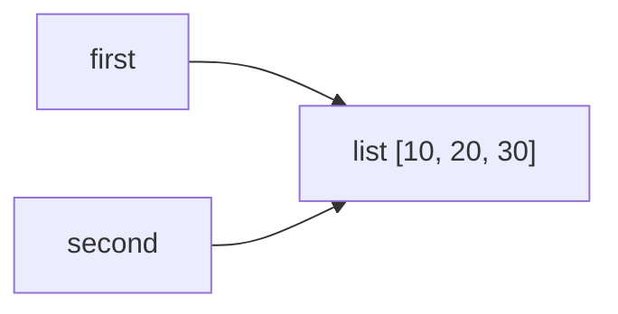
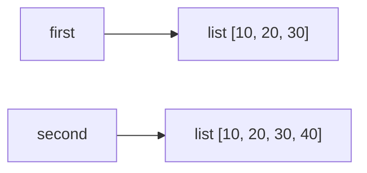
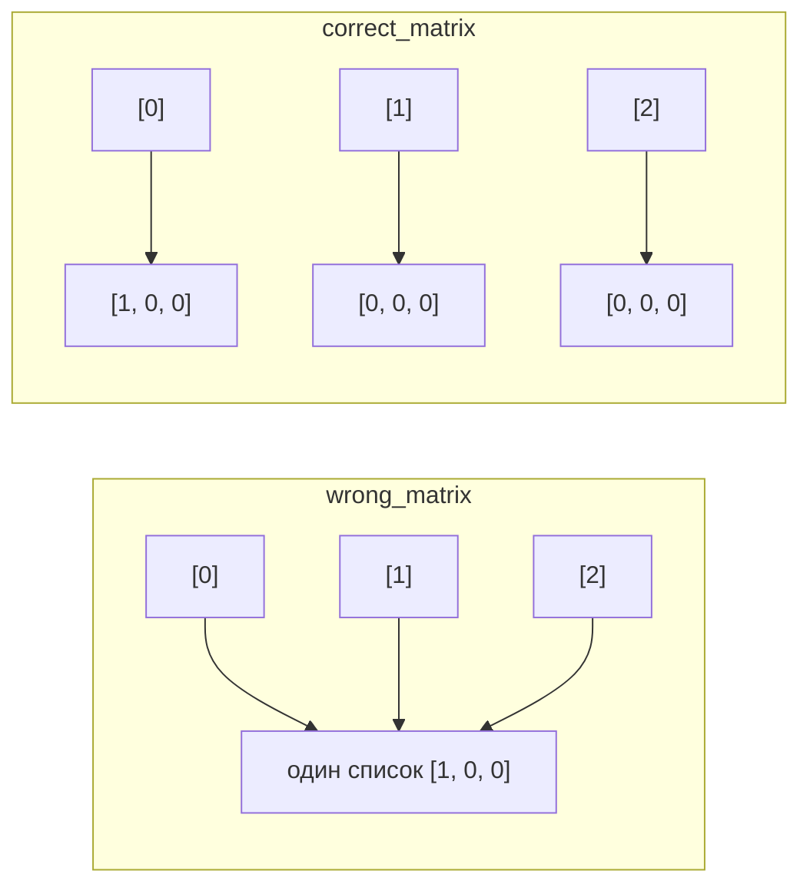
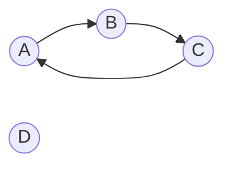

# Лабораторная работа № 2. Управление объектами и памятью в Python

## 1. Общая информация

**Темы курса:**

1. Ссылочная модель Python.
2. Изменяемость объектов, копирование.
3. Подсчет ссылок, сборка мусора и анализ использования памяти.

## 2. Цель работы

Исследовать связь между именами и объектами, понять различия между присваиванием, поверхностным и глубоким копированием, а также познакомиться с механизмами управления памятью в CPython.

## 3. Задачи работы

- объяснять ссылочную модель Python;
- находить случаи совместного использования одного изменяемого объекта;
- различать изменяемые и неизменяемые объекты;
- применять поверхностное и глубокое копирование;
- объяснять назначение подсчета ссылок и циклического сборщика мусора;
- использовать `sys.getrefcount()`, `sys.getsizeof()`, `gc` и `tracemalloc`;
- интерпретировать результаты простого исследования памяти;
- избегать типичных ошибок при создании вложенных структур.

---

## 4. Ход работы

## Задание 1. Имена, ссылки и изменяемость

В файле `task_1.py` выполним два эксперимента

### Эксперимент A. Неизменяемый объект

В файл `task_1.py` добавим следующий код

```python
a = 10
b = a

print(a, b)
print(id(a), id(b))

a += 1

print(a, b)
print(id(a), id(b))
```

**Прогноз:** сначала `a` и `b` обозначают один объект `10` (одинаковые `id`). После `a += 1` `a` будет связано с новым объектом `11`, а `b` останется связано с `10`.

**Фактический результат:**

```
10 10
140234328930864 140234328930864
11 10
140234328930896 140234328930864
```

Прогноз подтвердился. Операция `a += 1` не меняет объект `10` (`int` неизменяем), а вычисляет `11` и перепривязывает имя `a` к другому объекту. Имя `b` никто не трогал, поэтому оно по-прежнему указывает на `10`.

### Эксперимент B. Изменяемый объект

В файл `task_1.py` добавим следующий код

```python
first = [10, 20]
second = first

print(first, second)
print(id(first), id(second))

second.append(30)

print(first, second)
print(id(first), id(second))
```

**Прогноз:** оба имени обозначают один список, поэтому `append` через `second` будет виден и через `first`; `id` не изменится.

**Фактический результат:**

```
[10, 20] [10, 20]
140234318535168 140234318535168
[10, 20, 30] [10, 20, 30]
140234318535168 140234318535168
```

Прогноз подтвердился: список изменился на месте, имен два, объект один.

**1. Дополним программу: переназначим `second` на новый список и сравним списки с помощью `==` и `is`, изменим новый список и проверим повлияет ли он на `first`**

```python
second = list(first)
print("first == second:", first == second)
print("first is second:", first is second)
second.append(40)
print("first =", first)
print("second =", second)
```

Операция `==` даст `True` (значения равны), `is` - `False` (объекты разные); изменение `second` на `first` не повлияет.

**Фактический результат:**

```
first == second: True
first is second: False
first = [10, 20, 30]
second = [10, 20, 30, 40]
```

**Схемы связей между именами и объектами**

До переназначения:



После переназначения `second = list(first)` и операции `second.append(40)`:



### Практическая задача: конфигурации учебного проекта

Каждая конфигурация - словарь с названием, списком участников и вложенным списком параметров запуска.

**1) Присваивание** (`config_2 = config_1`) - нежелательное совместное изменение:

```
до изменения:
config_1: {'name_of_project': 'Учебный проект CS-2', 'list_of_members': ['Donk', 'Simple', 'Monesy', 'ZywOo', 'Rostislav'], 'game_parametrs': [['--Chosen map', 'Mirage'], ['--Players', '5'], ['--Bad players', '4']]}
config_2: {'name_of_project': 'Учебный проект CS-2', 'list_of_members': ['Donk', 'Simple', 'Monesy', 'ZywOo', 'Rostislav'], 'game_parametrs': [['--Chosen map', 'Mirage'], ['--Players', '5'], ['--Bad players', '4']]}
После изменений через config_1:
config_1: {'name_of_project': 'Учебный проект CS-2', 'list_of_members': ['Flame', 'Ropz', 'Buster', 'Exile', 'Evelon'], 'game_parametrs': [['--Chosen map', 'Mirage'], ['--Players', '5'], ['--Bad players', '5']]}
config_2: {'name_of_project': 'Учебный проект CS-2', 'list_of_members': ['Flame', 'Ropz', 'Buster', 'Exile', 'Evelon'], 'game_parametrs': [['--Chosen map', 'Mirage'], ['--Players', '5'], ['--Bad players', '5']]}
config_1 is config_2: True
```

Изменение, сделанное через `config_1`, переместилось в `config_2`, потому что это один и тот же объект в памяти.

**2) Глубокая копия** (`copy.deepcopy`) - независимая конфигурация. Поверхностной копии (`dict.copy()`) здесь недостаточно: списки участников и параметров остались бы общими. Независимость подтверждена `assert`:

```python
assert config_1 is not config_2
assert config_1["list_of_members"] is not config_2["list_of_members"]
assert config_1["game_parametrs"] is not config_2["game_parametrs"]
assert config_1["game_parametrs"][0] is not config_2["game_parametrs"][0]
```

```
После изменений через config_1:
config_1: {'name_of_project': 'Учебный проект CS-2', 'list_of_members': ['Flame', 'Ropz', 'Buster', 'Exile', 'Evelon'], 'game_parametrs': [['--Chosen map', 'Mirage'], ['--Players', '5'], ['--Bad players', '5']]}
config_2: {'name_of_project': 'Учебный проект CS-2', 'list_of_members': ['Donk', 'Simple', 'Monesy', 'ZywOo', 'Rostislav'], 'game_parametrs': [['--Chosen map', 'Mirage'], ['--Players', '5'], ['--Bad players', '4']]}
config_1 is config_2: False
```

**Итог:**

| Вариант | Общие объекты | Независимые объекты                                              |
|---|-------|------------------------------------------------------------------|
| Присваивание | весь словарь, список участников, все параметры | -                                                                |
| `deepcopy` | неизменяемые примитивы (мелкие целые числа int, строки str, булевы значения bool)      | словарь, список участников, список параметров и вложенные списки |

### Вопросы для анализа

1. **Меняет ли присваивание `second = first` сам объект?** Нет. Присваивание только связывает еще одно имя с уже существующим объектом, объект не изменяется и не копируется.
2. **Почему операция над неизменяемым объектом приводит к связыванию имени с другим объектом?** Неизменяемый объект нельзя поменять на месте, поэтому результат операции - это новый объект, и имя перепривязывается к нему.
3. **Как определить, что два имени обозначают один объект?** Оператором `is` или сравнением `id(a) == id(b)`.

---

## Задание 2. Поверхностное и глубокое копирование

Используем исходную структуру в файле `task_2.py`

```python
import copy

original = [
    ["Python", 5],
    ["Algorithms", 4],
]

alias = original
shallow = original.copy()
deep = copy.deepcopy(original)

original.append(["Databases", 5])
original[0][1] = 3
```

**Прогноз:**

* `append` в `original` изменит `alias` (тот же список), но не `shallow` и `deep`;
* `original[0][1] = 3` изменит вложенный список, который делят `original`, `alias` и `shallow`, в то время как `deep` останется прежним.

**Фактический результат (значения):**

| Этап | original | alias | shallow | deep          |
|---|---|---|---|---------------|
| Исходное состояние | `[['Python', 5], ['Algorithms', 4]]` | то же | то же | то же         |
| После `append` | + `['Databases', 5]` | + `['Databases', 5]` | без изменений | без изменений |
| После `original[0][1] = 3` | `['Python', 3]` в первом | `['Python', 3]` | `['Python', 3]` | без изменений |

**Идентификаторы** (id у `original` и `alias` совпадают, `deep` всегда отличается):

```
id внешних списков:
  original: 140394209917120
  alias:    140394209917120
  shallow:  140394209759808
  deep:     140394209764224
id первого вложенного списка:
  original: 140394210800384
  alias:    140394210800384
  shallow:  140394210800384
  deep:     140394209769344
id объекта с первой оценкой (5):
  original: 140394226284880
  alias:    140394226284880
  shallow:  140394226284880
  deep:     140394226284944
```


### Таблица сравнения способов копирования

| Операция | Новый внешний объект | Новые вложенные объекты | Изменения независимы |
|---|---|---|---|
| Присваивание | Нет | Нет | Нет |
| Поверхностная копия | Да | Нет | Только для внешнего уровня (добавление/удаление элементов); вложенные изменения общие |
| Глубокая копия | Да | Да | Да |

### Ошибочное создание матрицы

```python
wrong_matrix = [[0] * 3] * 3
wrong_matrix[0][0] = 1
```

```
wrong_matrix:
[[1, 0, 0], [1, 0, 0], [1, 0, 0]]
  id строк: [140196780883456, 140196780883456, 140196780883456]
```

Правильное создание без `deepcopy()`:

```python
correct_matrix = [[0] * 3 for _ in range(3)]
correct_matrix[0][0] = 1
```

```
correct_matrix:
[[1, 0, 0], [0, 0, 0], [0, 0, 0]]
  id строк: [140196780866496, 140196780867264, 140196780866432]
```

**Объяснение:** выражение `[[0] * 3] * 3` один раз создает вложенный список `[0, 0, 0]`, а умножение внешнего списка на 3 лишь повторяет **ссылку** на этот объект три раза. Все три элемента внешнего списка - один и тот же объект, поэтому изменение через одну «строку» видно во всех. Генератор списка на каждой итерации выполняет `[0] * 3` заново и создает отдельный объект.



### Вопросы для анализа

1. **Чем поверхностная копия отличается от глубокой?** Поверхностная создает новый внешний контейнер, но элементы в нем - те же объекты (копируются ссылки). Глубокая рекурсивно копирует и вложенные изменяемые объекты.
2. **Почему глубокое копирование не следует применять автоматически ко всем объектам?** Оно медленнее и расходует больше памяти, копирует то, что можно было безопасно разделять, а для объектов с ресурсами (файлы, соединения, блокировки), а также общих по смыслу данных может быть неправильным или невозможным.
3. **В каких случаях достаточно поверхностной копии?** Когда вложенных изменяемых объектов нет (список чисел или строк), или когда вложенные объекты менять не планируется, либо их общий доступ - намеренный.

---

## Задание 3. Подсчет ссылок и время жизни объекта

### Счетчик ссылок

Добавим данный код в файл `task_3.py`

```python
import sys

data = [1, 2, 3]
print("После создания:", sys.getrefcount(data))

alias = data
print("После создания alias:", sys.getrefcount(data))

container = [data]
print("После помещения в контейнер:", sys.getrefcount(data))

del alias
print("После del alias:", sys.getrefcount(data))

container.clear()
print("После очистки контейнера:", sys.getrefcount(data))
```

**Прогноз:** 2 → 3 → 4 → 3 → 2 (на единицу больше реального числа ссылок из-за временной ссылки-аргумента).

**Фактический результат:**

```
После создания: 2
После создания alias: 3
После помещения в контейнер: 4
После del alias: 3
После очистки контейнера: 2
```

Прогноз подтвердился.

**Объяснение:**

* **Почему `sys.getrefcount()` показывает на одну ссылку больше?** Объект передается в функцию как аргумент, а на время вызова параметр функции - это еще одна (временная) ссылка на объект.
* **Что увеличивает счетчик:** присваивание другому имени (`alias = data`), помещение в контейнер (`[data]`, `append`), передача как аргумента в функцию.
* **Что уменьшает счетчик:** `del имя`, перепривязка имени к другому объекту, удаление/очистка элемента контейнера (`clear`, `pop`), удаление самого контейнера, выход имени из области видимости (например, завершение функции).
* **Почему `del alias` удаляет имя, а не объект?** `del` убирает связь имени с объектом и уменьшает счетчик на 1. Объект освобождается только тогда, когда счетчик достигнет нуля - то есть когда никто больше на него не ссылается.

### Слабая ссылка

Добавим следующий код в файл

```python
import weakref

class Record:
    pass

record = Record()
weak_record = weakref.ref(record)

print(weak_record())
del record
print(weak_record())
```

**Прогноз:** сначала выведется объект, после `del record` - `None`.

**Фактический результат** 

```
<__main__.Record object at 0x7fcac8993a10>
None
```

Слабая ссылка **не увеличивает счетчик ссылок**, поэтому не мешает объекту освободиться: после `del record` сильных ссылок не осталось, объект удален, и вызов `weak_record()` возвращает `None`.

**Пример полезности слабых ссылок:** кэши и реестры объектов (например, кэш вычисленных результатов или реестр открытых окон/сессий): запись должна исчезать, когда объект больше никому не нужен, и не удерживать его в памяти. Также слабые ссылки применяют, чтобы в паре «родитель - потомок» потомок ссылался на родителя без создания цикла.

### Практическая задача: реестр на `WeakValueDictionary`

```python
registry = weakref.WeakValueDictionary()

first = Record("first")
second = Record("second")
third = Record("third")

registry["first"] = first
registry["second"] = second
registry["third"] = third

del third                  
del second                  
```

**Прогноз:** после `del third` из реестра исчезнет `third`; после `del second` - `second`; останется только `first`.

**Фактический результат:**

```
Сразу после регистрации: ['first', 'second', 'third']
После удаления временной ссылки на third: ['first', 'second']
После удаления сильной ссылки на second: ['first']
first всё ещё жив: Record('first')
second в реестре: False
third в реестре: False
```

Слабый реестр не управляет временем жизни объектов: записи существуют, пока объект жив благодаря сильным ссылкам где-то еще, и пропадают автоматически, как только они исчезают.


### Вопросы для анализа

1. **При каком условии подсчет ссылок позволяет освободить объект?** Когда счетчик ссылок становится равным нулю, то есть на объект не осталось ни одной сильной ссылки. Циклы этим способом не освобождаются.
2. **Всегда ли освобождение Python-объекта означает немедленный возврат памяти ОС?** Нет. Память возвращается в аллокатор Python (пулы и арены), который может держать ее для повторного использования. ОС память получает назад только когда освобождается целая арена.
3. **Чем сильная ссылка отличается от слабой?** Сильная увеличивает счетчик и удерживает объект живым. Слабая счетчик не меняет и при удалении объекта начинает возвращать `None`.

---

## Задание 4. Циклические ссылки и сборщик мусора

Добавим данный код в файл `task_4.py`

```python
import gc

first = []
second = []

first.append(second)
second.append(first)
```

```
first ссылается на second: True
second ссылается на first: True

Автоматический сборщик включён: True
Пороги поколений: (2000, 10, 10)
Статистика поколений:
  поколение 0: {'collections': 4, 'collected': 138, 'uncollectable': 0}
  поколение 1: {'collections': 0, 'collected': 0, 'uncollectable': 0}
  поколение 2: {'collections': 0, 'collected': 0, 'uncollectable': 0}

id до удаления: 139872223376128 139872228465152
gc.collect() вернул: 2
```

**Прогноз:** после `del first, second` каждый список все еще ссылается другой, поэтому `gc.collect()` найдет и соберет 2 объекта.

**Фактический результат:** `gc.collect()` вернул `2` - прогноз подтвердился.

**Почему одного подсчета ссылок недостаточно:** после `del first, second` внешних имен нет, но `first` ссылается на `second`, а `second` - на `first`. Счетчик каждого списка равен 1 и никогда не достигнет нуля. Объекты недостижимы из программы, но по счетчику «живы». Циклический сборщик находит такие группы объектов, на которые ссылаются только они сами, и освобождает их.

**Назначение поколений:** большинство объектов живет недолго, а долгоживущие объекты редко становятся мусором. Сборщик делит отслеживаемые объекты на поколения: новые объекты проверяются часто и быстро, а те, что пережили проверку, переводятся в старшее поколение, которое проверяется реже. Это снижает затраты на сборку мусора.

### Эксперимент с отключённым сборщиком

```python
gc.disable()
try:
    for _ in range(5):
        a, b = [], []
        a.append(b)
        b.append(a)
    del a, b
    print(gc.collect())
finally:
    gc.enable()
```

```
Сборщик включён: False
Циклов создано: 5 (внешние ссылки удалены, объекты ещё в памяти)
gc.collect() вернул: 10
Сборщик восстановлен: True
```

Пять циклов по два списка - 10 объектов, все они были собраны ручным вызовом. Автоматическая сборка восстановлена через `gc.enable()` (в `finally`, чтобы это произошло в любом случае). Построение программы на постоянных ручных вызовах `gc.collect()` не требуется: это экспериментальный прием.

### Практическая задача: граф

Три узла A → B → C → A образуют цикл, узел D независим. Узлы - словари с полями `name` и `links` (список ссылок на другие узлы).



Соответствие коду:

```python
node_a["links"].append(node_b)   # A -> B
node_b["links"].append(node_c)   # B -> C
node_c["links"].append(node_a)   # C -> A  
```

```
Собрано до создания графа: 0
  A -> ['B']
  B -> ['C']
  C -> ['A']
  D -> []
Собрано после удаления графа: 6
Независимый узел D остался доступен: {'name': 'D', 'links': []}
```

Было собрано 6 объектов: 3 словаря-узла и 3 списка `links`. Узел D не пострадал: на него ссылается имя `node_d`, и проверка `assert node_d["name"] == "D" and node_d["links"] == []` прошла.

### Вопросы для анализа

1. **Как возникает циклическая ссылка?** Когда объекты прямо или через цепочку других объектов ссылаются друг на друга (A → B → A или A → A).
2. **Почему объект с ненулевым счетчиком ссылок иногда может быть недостижим из программы?** Счетчик учитывает и ссылки от других объектов. Если все оставшиеся ссылки идут от таких же недостижимых объектов (цикл), то счетчик ненулевой, а из программы добраться до них нельзя.
3. **Зачем сборщик мусора разделяет отслеживаемые объекты по поколениям?** Чтобы чаще и дешевле проверять молодые объекты (большинство из них быстро становятся мусором), а старые проверять редко. Полный обход всех объектов был бы дорогим.

---

## Задание 5. Исследование потребления памяти

### Часть 1. Размер отдельных объектов

```
пустой список           : 56 байт
список из 10 int        : 136 байт
кортеж из 10 int        : 128 байт
строка из 10 символов   : 51 байт
целое число 10          : 28 байт
None                    : 16 байт
```

Кортеж занимает меньше, чем список из тех же значений: у него фиксированный размер и нет запаса места под добавление. `getsizeof` возвращает размер самого объекта: у контейнера это заголовок и массив указателей. Размер объектов, на которые указывают элементы, **не включается**: контейнер хранит ссылки (по 8 байт), а не сами объекты. Эти объекты существуют отдельно и могут быть общими для нескольких контейнеров.

### Часть 2. Рост списка

```
len=  0  size=56
len=  1  size=88
len=  5  size=120
len=  9  size=184
len= 17  size=248
len= 25  size=312
len= 33  size=376
len= 41  size=472
len= 53  size=568
len= 65  size=664
len= 77  size=792
len= 93  size=920
```

**Ответы по наблюдениям:**

* **Увеличивается ли размер списка после каждого `append()`?** Нет, только в некоторых случаях (12 раз за 100 добавлений).
* **Почему список резервирует место с запасом?** Выделять память при каждом добавлении дорого (потребовалось бы копировать массив). Запас позволяет большинству `append` выполняться без перераспределения памяти, так что добавление в среднем получается быстрым (амортизированно O(1)).
* **Чем длина списка отличается от объема выделенной памяти?** Длина (`len`) - число реально хранящихся элементов, а выделенный объем - вместимость массива указателей, которая обычно больше длины.

### Часть 3. Измерение через `tracemalloc`

```
list(range(100_000))  : текущий    3898.27 КБ, пик    3898.39 КБ
range(100_000)        : текущий       0.08 КБ, пик       0.08 КБ
```

**Прогноз:** список займет порядка нескольких мегабайт (100 000 указателей и объекты `int`), а `range` — доли килобайта.

**Вывод:** `list(range(100_000))` — **материализованная** последовательность: в памяти хранятся все элементы (массив ссылок и объекты `int`), поэтому память растет вместе с размером данных. `range(100_000)` хранит только правило получения значений (начало, конец, шаг), поэтому занимает фиксированный малый объем независимо от длины, а значения вычисляются по мере обращения.

### Практическая задача: утилита `memory_report.py`

Измерение (`measure`, `collect_measurements`) и форматирование (`format_report`) разделены: результаты сначала собираются в список объектов `Measurement` (dataclass), затем печатаются.

```
Сценарий            Элементов   Размер, Б   Текущая, КБ     Пик, КБ
list(range(N))         100000      800056       3898.27     3898.39
tuple(range(N))        100000      800040       3898.26     3898.38
range(N)               100000          48          0.08        0.08

Отношение пиков list(range(N)) / range(N): 49899x
```

Разница между `getsizeof` и `tracemalloc` для списка видна явно: `getsizeof` показывает ~800 КБ (только массив указателей), а `tracemalloc` ~3900 КБ, так как учитывает и 100 000 созданных объектов `int`.

### Способы уменьшить лишнее потребление памяти

1. **Использовать ленивые объекты вместо материализации** (`range`, генераторы, итераторы). Связь с экспериментом 3 части 5: `range(100_000)` занял ~0,08 КБ против ~3898 КБ у списка.
2. **Выбирать подходящий контейнер:** если данные не меняются, использовать кортеж вместо списка, так как кортеж не резервирует запас. Связь с частями 1 и 2: кортеж из 10 элементов меньше списка (120 против 136 байт), а список растет с запасом.
3. **Не копировать данные без необходимости:** использовать ссылки на общие неизменяемые объекты и поверхностную копию вместо глубокой там, где это безопасно. Связь с заданием 2: `deepcopy` создает новые вложенные объекты, а неизменяемые значения (`5`) остаются общими.
4. **Не удерживать объекты лишними ссылками:** использовать `del`, ограничивать область видимости, применять `weakref` для кэшей и реестров. Связь с заданием 3: `WeakValueDictionary` не продлевает жизнь объектам, а переменная цикла `rec` оказалась скрытой сильной ссылкой.
5. **Избегать циклических ссылок или разрывать их** (в том числе через слабые ссылки), чтобы память освобождалась сразу по счетчику, а не ждала цикла сборщика (задание 4).

---


## 5. Вывод

В ходе работы исследована ссылочная модель Python: имена - это ссылки на объекты, а присваивание не копирует данные. Изучены различия между присваиванием, поверхностным и глубоким копированием, подсчет ссылок, слабые ссылки и циклический сборщик мусора, а также измерено потребление памяти разными представлениями последовательностей.

**Наиболее опасные ошибки при работе с изменяемыми объектами:**

* **Принять присваивание за копирование** (`b = a`): изменение через одно имя неожиданно меняет данные, видимые через другое (задания 1 и 2).
* **Поверхностная копия вложенной структуры:** внешний список новый, а вложенные объекты общие, поэтому изменения «просачиваются» между копиями (задание 2).
* **Создание вложенных структур умножением** (`[[0] * 3] * 3`): все строки - один объект (задание 2).
* **Скрытые сильные ссылки** (переменная цикла, кэши, контейнеры), из-за которых объекты живут дольше ожидаемого и расходуют память (задание 3).
* **Циклические ссылки в больших структурах**, которые не освобождаются по счетчику и ждут сборщика (задание 4).